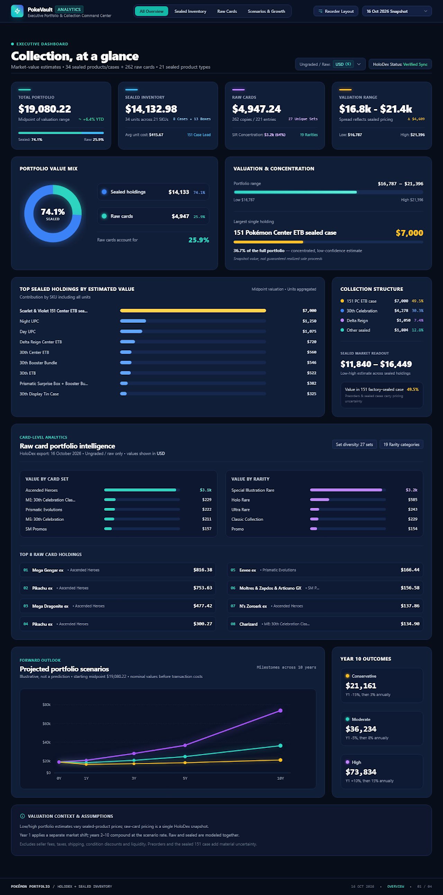

# Collection Tracker

Track a Pokémon trading card collection and its value over time. Import a CSV, sync TCGplayer prices for cards and sealed products (catalog from [TCGdex](https://tcgdex.dev), prices from [TCGCSV](https://tcgcsv.com), both free with no API key; see [docs/pricing.md](docs/pricing.md)), and see totals, gains, movers and breakdowns on a dashboard.

## What it will look like

This is the target design from the Stitch renders (source files in [`.renders/`](.renders/)). The current app has the colours, fonts and card styling, but not yet the sealed inventory, valuation ranges, scenarios or multi-currency views. Those are tracked in the [project roadmap](https://github.com/users/JakeDeFord/projects/3).



## Getting started

```bash
npm install
npm run dev
```

Open [http://localhost:3000](http://localhost:3000).

### Where your data lives

The collection is stored **in your browser**, not on the server: an embedded Postgres (PGlite) saved in the browser's IndexedDB. Everyone who opens a hosted copy gets their own private collection, and the server keeps nothing (it only forwards price requests to TCGCSV). This means:

- Another browser or computer starts with an empty collection; collections don't sync between devices.
- Clearing the browser's site data for the app deletes the collection. Use **Export CSV** to keep a backup, and **Import CSV** to restore it.
- Prices sync when you open the app (if the last sync is over 36 hours old) or press **Sync prices**, so value history only has points for days you used it.

`npm run dev` starts with a pre-filled demo collection (cards, sealed products and price history) in a separate `collection-tracker-demo` browser database, so it never mixes with your real data. Delete that IndexedDB database in the browser's dev tools to regenerate it, or set `SEED_DEV_DATA=0` to use your real collection in dev.

### Environment variables

| Variable | Purpose |
|---|---|
| `SEED_DEV_DATA` | Set to `0` to skip the demo data in `npm run dev`. |

## Scripts

- `npm run dev` – start the dev server
- `npm run build` / `npm start` – production build and server
- `npm run lint` – lint
- `npm test` – unit tests
- `npm run db:bundle` – bundle the `drizzle/` migrations for the browser (runs before `dev` and `build`; run it after `drizzle-kit generate`)

## Tech

Next.js, React, Tailwind CSS, Drizzle ORM, PGlite (Postgres in the browser), Recharts.

## Changelog

See [CHANGELOG.md](CHANGELOG.md).
